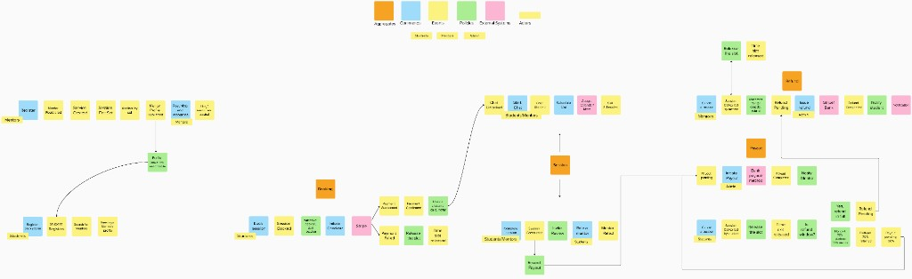

### EventStorming

The EventStorming session covered the full flow, from mentor and student registration, and student searching and finding mentors through to booking, payment, sessions, payouts and refunds.

The board is on [Mural](https://app.mural.co/t/vuiworkspace8647/m/vuiworkspace8647/1792159724048/96beda2829dd92b771306787d9a867793835070d).

### Domain Model

The domain model covers the main concepts of the problem domain.

The diagram is on [diagrams.net](https://viewer.diagrams.net/?tags=%7B%7D&lightbox=1&highlight=0000ff&edit=_blank&layers=1&nav=1&title=Domain%20model%20and%20Component%20diagrams&dark=auto#R%3Cmxfile%20pages%3D%222%22%3E%3Cdiagram%20name%3D%22Domain%20model%20diagram%22%20id%3D%22f70IJ6838qOr__fpMa-q%22%3E7Z1dk6I4FIZ%2FjTdbNRaETy%2B77ZndrZqu6tre2Y9LlKjZAeICduv8%2Bg1IFAgtSBJotzM1VSMHgpLz8njykjgTYx7uf4697eYR%2BzCYAM3fT4yHCQC6M9PIP1nkUEQ0zTpG1jHyi9g58Ix%2BQHpgEd0hHyaVA1OMgxRtq8EljiK4TCsxL47xa%2FWwFQ6q77r11pAJPC%2B9gI3%2Bifx0c4y6lnaO%2FwLRekPfmVzgcU%2Fo0YOLQLLxfPxaChmfJ8Y8xjg9vgr3cxhkvUf75djuyxt7Tx8shlHapcGv3%2F6Y%2F%2FHNeAjjaL%2FfJwg8Gv9%2BstizFCdO0gPtg%2BQVhYEXka37FY7S52KPQba9AK0j8npJmsOYBF5gnCLSfXfFjhRvSXS5QYH%2F1TvgXfYmSeotv9Ot%2Bw2O0Q9yWi8gu3QSILvjtFCCYU%2B1yjHPWVuyI4vGMCFHPdHPrtdCj96%2BcuBXL0mLwBIHgbdN0CK%2FkCwSevEaRfc4TXFYhDZpSD%2FSCgXBHAc4zjvE%2BJL%2FIfFjV714wa7oqm8J6YVjkHQE3Je6tMjKzxCHMI0P5JBNSTj0Rnk9i%2Bx0DxRncTQwLfJ1qDbyCpGvT%2Bc%2B64C8KKRwhSxsVhaX5FPSCrnmNM9hjL9D2mURPoqn1ItFiOongKv0TfUkW2%2BJovXX%2FJgH%2Bxz5reg%2Fk4QwabsK8htsg3wfRlneceql3jnJW4yiNO8r6578Jb0310iXWuSDz8m2ft4mf7PD43SOI3ItHsq7ARIFvcIkrYqDEUHkhXAC7CA7bkHkYK%2BzVzD0UNBLG5b5tjYKJRi2JCU4HIDQFSAYbTzvFv%2BQ76m7GHq9tGDPGC3oM6vCCcOtakMaJdyOlHAUJd6kRA8JGMbbEpCNg5nCgVAcPJL3xcIqhjYSkLpVki50jRXGJQEpFlRksEB4nQ2gDg1lw34LYwSjZT9YNNQOg8FCbxijKFpw0OIJk%2FfoowKdpqIsA9eZVnFh21VhSMQF6IgLndWL4gXpA5QGDUOMJRFx1p%2FMju1uEZCrThGOHry0H0kc65KEpLPEUCwROxBJd36uFTmDEF23B6s9zK4wMRRMGpRwc4MQnce1VCxgFfA7CuFzgPvBoMc4xJxJY0FX51JX1mWTEnIVNwxCIv%2F2Rh%2FKuhRcMcD4BfUchvYbgEjkRFfvUlfm5RUDEB8myxhts3EGu3MFb3LgoSxPsRh5hEmSPXSXVGswAw95EAFdTU9duZ6NEMn6gMFEQvryrl8pOma50TQhQ3GCgxP3GH8n2u1XboB2UMz0%2BnQKW9qTUjrIbiVFg2QUKQDwc9OScTXjvuWoOyYoeJxMbQBQWM5tgWIyB5M7MkTdhTDOLe4scH%2FP6uUUoYECMeT60l1C95KkLs4t%2BsDHuuCNvVWlSGRPV3sUKHu0SV5PMPLJp3vyDmHjsxVyzhWKQ%2Bg37Qq3AUwbd3nRkiQP9vNVZnYrvyxHlp6U%2ByqWXydlDWO%2BzgxppOlqvgJlvjYJwQvxrokwft9HtqOOh5T9KhYTv8HVrqcN30SJVvNVIie6mq9Ama%2BjcWI4hxUoh1V4QZFdlaR6gvVN5JHC6OqwAuWw%2Fu8rCkM5rKIrihcEX2VxgrE4JGKiq71qKHu1SQiZbZY57ex80rD3yHRUUhROFvSZxb0sOvAuXsILJ2O%2FWUpdGRO%2B%2BtAv0pW9HwUOScUGr3HkBZ%2FP0WwizV22KpkcsAhwBocs9AVl13c8RUQXQesg29yj9K9s19Qxis2%2F6ZHk9cO%2BvHE4nYN04rGVRTf%2FLj5wvnFulm%2FRdscLJUBbw0s3kcXop1kNMQyIrl6qGWjKdd6UdIt3KB1QSP985qcscMaLBeplCDBrC6BrLVytXtLWWpAXx09xVt7pcjjEaAoUY8MU1lHUaCkxlqWlA6tFW%2B9GjdYNoLH4rs1rKxrzESlmI%2F%2F3DYrorpJQy2WYblekCnqB89hKsFgdRqzJFi4RqSl%2BwCTLXMQpXr5vzeLruPgpjaIMmYDO01wM1tbN0v7VW8CAFral4qaklZaqalFUumzl8lPn2qSxD4smn9p4wNy9duXO%2FQSq7fFqlcCUSYiI29cZPUfxsca7Ikn6dComT1en6dNoeXJvB7MUlXqZk6dv%2BDZSljGpTU0xoKSzhUsiypewJRuYXCEb8Yic8d5%2B7uCIpF35URBZVFFj5uh6RH40Ppr67fCxYxladwMvlaF6R7jWylBNEF3ZQdPGG5WrJuC8Z6meFFfl3bLG6DlSXG1Nkkiz6Sa46up9uGrJwCo7vCeJhjEvWfvZo0bdXjJNapi%2BZUk5lnu5hRxLyrR4wWIq%2BMvmCq83xJ8jBf%2FWJDkC4S%2FtSUPNddAmPVwHfSLFdWABvsD4%2Byj81jXm114N0AbwhkbWEA8VTJeXDuxEP%2BUcC84Rr3XFnyNF8LYk0Z8VF0PwgXzj6tPgziW440iowU%2BF2bt7Hmxb7fS2mRWp9UZy%2BG3pnGygulX8locGXouMP0c9nvx9NH6LnHg2FL97PferV%2BBADL9ZZzrJJyBqi8MVuhHHcWPWUlB3aaIDZxCKm7yEYId8iuKCc8TrdfHnSFG8NUm2SIqzE27eURVepTiwxFC8oQonwoTxS7bcfSSUm069InfAANaIxTthi4pRmdvy7nde%2B4o%2FR9dDWZtOPxyXZwK53LB0bIDq2nD6zaszBIHZYHSUFD9%2BM97kD5t3wpbFDpRU3Sr21rO5HSLuHKm6tTVJ4Ab5WHv%2BZ4OugDwzUaR%2F%2FD7WE5l0EistVa1BHASbd4oXVaAqVuXd5LwuD3%2BO1AqQLnkSudBuHBi7nYtVKfPpADsdYwwW12fFObMhSMw738oefi3ehyMxr7XDnyNlG3TJk8i1eIORuN%2BkCikcnonmMJ9dwDuRyVZr8GTfcg6vpcOfI4XGLnkSuQxvODS67nthI%2F1BqbHnm2lu9dmW67bMNWMnqNWayKlrHcAJBocVmYK34BzxukD8OVLw7pInkWv9LsObhbHvJZuc5nqFzFqZzJd%2FbEcKOJnszECdc3QC1%2BkkR8gX7a5JE9mMMU7Lh2f%2Fifsj9jOdf%2F4P%3C%2Fdiagram%3E%3Cdiagram%20id%3D%22Pc_xOG8s3eQwtYZtFQck%22%20name%3D%22Component%20diagram%22%3E7V1bl6K4Fv41Pk4vIFzkUe2umrOm%2B6w%2BVWtmes5bhKhMA2EgVpXz6ycBgpCgokVAe5yHHokh6Le%2F7Fv2tiZgEb09pjDZfME%2BCieG5r9NwMeJYeiWo9P%2FsZFdMTKdGsXAOg38ctJ%2B4Dn4G5WDWjm6DXyUNSYSjEMSJM1BD8cx8khjDKYpfm1OW%2BGw%2BdQErpE08OzBUB79PfDJpvwWlrYf%2FxkF6w1%2Fsq6V70SQTy4Hsg308WttCHyagEWKMSleRW8LFDLwOC7FfQ8H3q0%2BWIpi0uWGX3779v%2BH5ePPq8en1%2Bco%2FdXEePaT7ljyOuXSGdlxFFK8jX3EFtInYA5TrxQUlRKYv24Cgp4T6LGRV0oDOrYhUVjOXuGY8On0S8%2BLxV9guC0XnyyMyWz%2BhCAVn6E9f52xgTmdZ4f0A82XKX21Zq9mSVLejFKC3moftvzGjwhHiKQ7OmVTE4pTSuB1L0Cdj5WrGKC83gnvw5I%2F62rpPcT0RYnyWYjbMuLHZVMTBCVRwl5G2N%2BysfmfiJAdZ6bNBypKgqYsZOwvwVO3ZTzNBpy6OW3A6SgD0xmdvrMt2dBnBx4kAY4Zg1H6EtDVFFHVNoej6rQzVZ07VU%2BB6Y5O1S%2F0wTgdnqKGq4yiU210VOcYfw%2Fi9YTZXxtGST5H%2Bwp3EftEg4NtAnVgtzgdx8Vy1weHITJGZ%2B5iA0cgqKXOYE1BZ4Iad4KeAtMcnaBP6CVAr8NT1NHUUbQl4DqO%2F52ihyFqiaUGpii183hLBOP%2FhFb0kep56xpN3tq2Ot62RFrHhXLn7WGIWgKrgXn7X0yC1WBBq0jUqUIF2xJnHZfCnagHIXLHD6%2BK9CBL%2Bh7KCybrmR8F8UVY2y3c1TUBbDHCUqdl3c4RlnuzEdZ0KO52CrDoSkGSMbQ4fF6It%2F5p4kpwPZM0oAtI9OQjjOmNZ9t%2FbTF%2F46cs3wMzN3nbv1GtkG8B9EZQGkNhG1BsioX5wy5R4IYsM1tU4FZzD3B6KJBbSxCnUm6PGK%2Fpqoa2gCGKfZjmztwD%2FfcLQuQW5WmfL08LTJXJs1Mc2Z88P0UwYJ8qSfFL4KP0JiXYYpZOSNDV1VmlToeEldx2YUDdgRSclt2ycBw%2BL%2FlAdjTUwhlZp%2Bj5f58vs0yaDOpUMPVANPWmOlA7xa4c1G0UzjyWvAdz9rWp4x5%2BhksUUkyC3IUHH5eYEBzVJszCYM3eIPi06dr6ebL6AlgtS0IVCKhaTVCrawWgdjoPHAZUftoyCKYVkxVg2ilYHQbTyx39DpCaPClcYgoUbv4zDwM1Ja56i5tgNCABmttkGTAVIWJoZ0aaYyHCvRmuy7gkFSDSEgteISI2aCICdHWIdIrorg4R01KHSKdY6eoQsRTumjNPra4EEcdQh8iZJX5XgohKzVq63siXij9liPA29dAxW95S%2B1SDz4fZpkqNotifsaJUeokTFBcj9WRpUwrs8z2Xq%2BKUbPAa02jz0360kT1ld4TM1ZpD7%2Fs6X2mBQ%2BaJ0Y8EVvl%2FbNG3gHxj8z9o5dUf7HEfrPLq4xt%2FOrvY8YuYIv8tn2gbFh8o7qze39%2BaX%2FF7C3gITNfoeErTkri22CDvOx3aZiyO13xI4IRnZ7wUQYKqN9sYmKIQkuClKeQ2PuW3UtHAXW1CgoOYZLWVv7KBerToCk54udX25CyW3FO1%2BmzvYa9zBntvi5OGIZDSBnZXWgJnOFo%2B0wCHMS9J8SoIEeXIgoFdnKGVVySI2JQsxKQcSXDWoNOARHWaRAX6EaLKt1fpKO7QiPV8hZIsbxO0cy%2BUn%2FapsFuK025hc%2BxVdI3fp3eG7n7Qbae%2BNfQPpmV12hwtmrhe5rBh3RRSdrVG%2FD7ILtFxagpHEbbVXKLY0grZ6N7ZKLkPelc9zY7dh9bTy6JENxP4mxQ1uqPo5Kl4oAacOllPz2%2F6Gi063zp6gyLnhB9C3PdGbW8A3ey6OzTdbe4OU3f62h%2BGtD9ypc7L1x5kVf6Klhu6dd65P94XrOn6nVFysGa43RkFmozqZvo78AnIfOIhWYQQKXoiwiB%2BL38u069T0Us4oV%2BF%2BZbtDqEujTu5JXI7JuhMbjXU5iWsdVcCZVlRKunhKAkRodgc0JoejD0qfDZhBN4LoR4%2F1DrIe2G%2B7Q7iJoA77yXeu2codcFJMNy%2BmD%2BVmL%2Fvb%2FNwvArS6FqZLzq87nEPWZw%2FBdoQzDfvzBdSGXrXVEZNwfcbOvKD%2Fxrrf41DnCc8vLxJTmQ6XJE8I53wNs8xPWSrV0oZN0kpUZlOLacrqZrnGfoQCYmIehNwjUbKBgvpXHsYxdfroVtLk9EtsrTzodvwFE3aGttS3tiWIg%2Bn%2Fkj8nY7isp5z7Haav3Jz5y3y1%2Bme2XKGp3Catw%2BPQ1JTa5LUsQZRsv0elN2mkr0671KOqWpdww91terjGI3rS%2FZ7tiV3WP6rCARAX0rOlJUcyhmDim6XESlj9Hrk09LXeBuUucix01VlMFus4rgk6fUUx71Nw6RXp%2BSlsM3O%2Fr9AE93sS7M4MlFmnkfD03Hpcs65yG2ToKzF6VQ6oTdKJ%2FrzoVWR4CLX2RBam8CxwgXZ8XabWd2q%2FHmoWjWj16MN96gHVeN1zDxHkcgiTd%2Fv4DQZ2GPxjiYxMILxFoZVJkIs3il85pHVVKdmA94aVzYk%2B0%2For22QIv8%2FMUHpKu%2BNrRfcn2yba7XsZ1fkc7etVpHPh3hFPj%2BdriryLWVA9pnCrnrJzrMMrTtIiSmAZb9jiFbkSHLlUuegJx%2ByYndbo3BjK5adrmCW77x1kBVnI0VsG2J2dFh0bY63UftMPlfAXKaUr1Xc2rWFDGf1ct%2B6cuUl%2BSqA7DUpyNuybky5XuzyqFKuzkHlmuvRDMHU2wiKtvw1zCjXt5l8Kl1XxNR9Yn%2FboGpSaelRkQ61X2BAEQ7CgOyEJ4%2FWu1LtC75PjCEOe4w%2B06CVrH8we6Ffl73gP%2Bfw77AXpqXMXoB%2Bc3V3e9HHbgNygNywF8u8Tn9RhMuV810U5OV6vyxfPWYySvOy75ZZ1JZosRe8Era%2B%2FvgWgveDqbUQ4JwM5UkLAY5GrDdrIQyJs%2BNaiE6%2FlvGjWAhLXboG9FrEercQ%2FVgIuR%2FnZLpG1OhZcajMqxKgPxm3VlHU7fYgTYyg12wkl8sPpttlto2r28%2F6OcVb1%2B2OoU6391rneNft%2Fej2loa0uvef8rZL%2FpOTYytqBwyiqPvMbFYg%2F2CKWj7FUaOo6eX%2Br5kWIt7%2FTVjw6R8%3D%3C%2Fdiagram%3E%3C%2Fmxfile%3E).

### Component Diagram

High-level overview of the system.

The diagram is on [diagrams.net](https://viewer.diagrams.net/?tags=%7B%7D&lightbox=1&highlight=0000ff&edit=_blank&layers=1&nav=1&title=Untitled%20Diagram.drawio&page-id=Pc_xOG8s3eQwtYZtFQck&dark=auto#R%3Cmxfile%20pages%3D%222%22%3E%3Cdiagram%20name%3D%22Domain%20model%20diagram%22%20id%3D%22f70IJ6838qOr__fpMa-q%22%3E7Z1dk6I4FIZ%2FjTdbNRaETy%2B77ZndrZqu6tre2Y9LlKjsAHEBu3V%2B%2FQZMFAgtSBJotzM1VSOHBCXn5fHkJTgTYx7tf0687eYR%2BTCcAM3fT4yHCQC6Y9r4nzxyOEZmrnYMrJPAJ43OgefgByRB2mwX%2BDCtNMwQCrNgWw0uURzDZVaJeUmCXqvNViisvuvWW0Mm8Lz0Qjb6Z%2BBnm2PUtbRz%2FBcYrDf0nXWN7Ik82pgE0o3no9dSyPg8MeYJQtnxVbSfwzAfPDoux35f3th7%2BmAJjLMuHX799sf8j2%2FGQ5TE%2B%2F0%2BDcCj8e8niz0KOXCaHegYpK9BFHox3rpfoTh7JnsMvO2FwTrGr5e4O0xw4AUmWYCH747syNAWR5ebIPS%2Fege0y98kzbzld7p1v0FJ8AMf1gvxLh0H8O4kI0ow7KlWafOc98U78mgCU9zqiX52vRZ69PaVhl%2B9NCOBJQpDb5sGi%2BJE8kjkJesgvkdZhiIS2mQR%2FUirIAznKERJMSDGl%2BIPjh%2BH6sULd2SovqV4FI5BPBBwXxpSkpWfIYpglhxwk01JODOiktezyE7XADmKo4Epydeh2skjIl%2Bfjn3WAX5BpHCFLGxWFpfkU9IKPuesyGGCvkM6ZDE6iqc0iiRE9RPCVfametKttwzi9deizYN9jvxGxs%2FEIYT7rsLiAtsEvg%2FjPO8o8zLvnOQtCuKsGCvrHv%2FFozfX8JBa%2BIPP8bZ%2B3sZ%2F8%2BZJNkcxPhcvKIYBYgW9wjSrioMRQexFcALsMG%2B3wHKw1%2FkrGHlB2Esblvm2NogSDFuSEhwOQOgKEIw2nneLf%2FD31F0CvV5asGeMFvSZVeGE4Va1IY0SbkdKOIoSb1KihwQM420JyMbBTOFAKA4e8fsiYRVDGwlw3SpJF7rGCuOSgBQLKjJYBGidz58ODWXDfguTAMbLfrBoqB0Gg4XeMEdRtOCgxRPC79FHBTpNRVkGrjOt4sK2q8KQiAvQERc6qxfFCzwGQRY2TDGWWMT5eDI7trtFiM86C1D84GX9SOJYlyQknSWGYonYiUi28wutyJmE6Lo9WO1hdoWJoWDSoISbm4ToPK6lYgGrgN%2BDCD6HqB8MesxDzJk0FnR1LnVlXTYpoVBxwyQk9m9v9qGsS8EVA0xegp7T0H4TEImc6Opd6sq8vGIC4sN0mQTbfJ7B7lzBm5x4KMtTLEYeYZrmN90l1RrMxEMeREBX01NXrmcjRPIxYDCR4rG861eKjlluNC3IUJzg4MQ9Qt%2BxdvuVG6AdFDO9vpzClnanlE6yW0nRIBlFCgD8wrRkXM2kbznqjgkKHidTGwAUlnNboJjMweQOT1F3EUwKizsP3N%2BzejlFaIAgBp9ftkvpXpzUxblHH%2FhYF7yxt6oUiezpao8CZY82yesJxj7%2BdE%2FeIWq8t4KPuQqSCPpNu6JtCLPGXV68xMmD%2FXyVmd3KL8uRpSflvorl10lZw5ivM0Maabqar0CZr01C8CK0ayKM3%2FeW7ajzIWW%2FisXEb3C162nDN1Gi1XyVyImu5itQ5utonBjOYQXKYRVeUORnJameYH0TeaQwujqsQDms%2F%2FuKwlAOq%2BiK4iWAr7I4wVgcEjHR1V41lL3aJITcNsuddnY9adR7ZjoqKYiTBX3m4V4WHWiXLOGFg7HfLKWhTDBffeiTdOXvR4GDU7FBaxR74edzNF9Ic5c%2FlYwbLEKUwyEPfQny8zseIqYPQesg39wH2V%2F5rqljkM2%2FaUv8%2BmFf3jicjoEH8djLopt%2Fkw9cbJy7FVu03%2FFEMdDW8NJFZDH6aVZDAkOsq5dqBppyXXTFw%2BIdSg2I9M9HfsoDZ7xYoF6GALP2AHSth6vVS9paD%2Fzi%2BCnOyjudDocYTYFibFjCOooaLSXGsrR0YLVo692o0boBNJLv2qK2ojE%2FwMVs7P%2B%2BCWK6qyTUchmm2xWpgl7gPPYSLFaHEWu6hcsA1xQ%2FYJpnLuYUL9%2B3Jvk6Jj%2BlQcqQCei8zMVgbd087V%2B9BQxpYVsqbkpaaamqFqTSZSuXnzrXJo1jSLp8auMBc%2FXalSv3E6j2R6tVCjMmISIuX2f0HCXHGu%2BKJOnTqZg8XZ2mT6Plyb0dzFJU6mVOnr7h20hZxqQ2NcWAkq4WLomoeIQt3cD0CtmIR%2BSM9%2FJzB0ckHcqPgkhSRY2Zo%2BsR%2BdH4aOq3w8eOZWjdDbxUhuod4VorQzVBdGUnTRtvVK6agPOapXpSXJV3yRqj50hxtTVJIs2mm%2BCqq%2FfhqiUDq%2Bz0HicaJrxk7WePGnV7yTSpYfqWJeVY7uUeciwp0%2BIFi6ngL5srvN4Qf44U%2FFuT5AiEv7Q7DTXXQZv0cB30iRTXgQX4AqHvo%2FBb15hfezVAG8AbOllD3FQwXV46sAv9lHMsOEe81hV%2FjhTB25JEf1ZcDMEH8o2rd4M7l%2BCOI6EGPxVm7%2B5%2BsG2109tmnkitd5LDb0vnZAPVreK3PDTwWmT8Oepx5%2B%2Bj8VvkwrOh%2BN3rvl%2B9Agdi%2BM0602mxAFFbHK7QjTiOG7OWgrpLFx04g1Dc5CUEO%2BVTFBecI16viz9HiuKtSbJFUpxdcPOOqvAqxYElhuINVTgWJkxe8sfdR0K56dQrcgcMYI1YvAu2qBiVuS3veue1r%2FhzdD2Uten0w3F5JpDLDY%2BODVBdG06%2FdXWGIDAbjI5S8uM34y3%2BsHkXbFnsREnVrWIvPZvbIeLOkapbW5MEbpCPtft%2FNugKyDMTRfrH7%2BN5IpMuYqWlqjWIg2DzLvGiClTFqryLnNfl4c%2BRegKkS55EPmg3DozdzsWqlPV0gF2OMQaL66vinNkQJOZdb2UP%2FyzehyMxr7XDnyNlG3TJk8hn8QYjcb9FFVI4PBPNYT67gHchk62ewZN9yTm8lg5%2FjhQau%2BRJ5GN4w6HRdd8LG%2BkPSo293kxzq%2Fe2XLdlrRm7QK3WRU5d6wBOMDisyBS8BeeI1wXiz5GCd5c8iXzW7zK8WRj7XropaK5XyKyVyXz5x3akgJPJzgzUOUcXcJ0OcoQ86XdNmvBmglBWbp7%2FJ%2B6PyM91%2Fvk%2F%3C%2Fdiagram%3E%3Cdiagram%20id%3D%22Pc_xOG8s3eQwtYZtFQck%22%20name%3D%22Component%20diagram%22%3E7Z1bd6M2EIB%2FjR%2B7h7vNozfJbh%2By2zTenj72yCDbagBRIcfJ%2FvrqyiUQYmwCXjt5SGCQBZ5vRpfRiEzsq%2FjpKwHp5hsOYTSxjPBpYl9PLMucGg77wyXPUuK7UylYExSqQoVggX5CJTSUdItCmFUKUowjitKqMMBJAgNakQFC8K5abIWj6l1TsIY1wSIAUV36NwrpRkpnrlHIf4dovdF3Ng11JQa6sBJkGxDiXUlk30zsK4IxlUfx0xWMuPK0XuTnvrxyNX8wAhO6zwfo2qRT%2BnP643pjfvkR%2FmPde9Fvs4ZqlCijz1oJ7NFTfriNo3lAMZnYn3cbROEiBQGX7xh7JtvQOGJnJjt8hIQipsVbsITRHc4QRThh15aYUhyXCswjtOYXKOY1RLz4ZxA8rAneJuEVjvjN2CPYK%2FHDimSU4AdYumKIH3ZlhaKo6RMrnNCm8vJrPoJoq77mgm5DrgUpZw8In0oaUVr9CnEMKXlmRTYl8J6ivCuMxFYiVYk9Mz4ZBpNOPV%2F8lleVX1gGv2q69szx%2BG9bmbAy33V%2B14IwO1CQuwC3PoDnwL8xFbBSY%2FC2rYF42x%2B8c97zMEbJO%2BE2LafVv6cD8Xa68A5wnOJEFHwLOFAcA1YakgbAMQpDXv%2BrmFrA7gtwYnkglnb03xazv%2FcQsE7fMhZ38%2FwaUdeYgFVm8ormaXoQdr%2BO3XSr3F2jFftQbu7ug134HOT1GG8DD0G2EWXNF0wTZjEH4WxuErRhRXDFzTBjD4SS9a04uxb0lOgHL37tqRss1Ncym%2ByEtzAwCZlwcmNNZsbEd7gmWCXsM5bxnQ1TP%2F2b8ctM65Zx85QSmPHzlOBAHB1gLO60bi3WtGot09ZGwvQHshbvnBuJ%2BZZu2P3ZbUWfxBoHSB4Re%2BKeGv58RK%2BZeq0tgOkOw3R6zkz1SO0olu6xLO2hBumzc2b5GeMH1hKL1ld12ez4DjzHYvI1rrvKUfsAiP1zRny1AceSPNpZnYFG3L5xziTv4SOCu7FZuu5ALDuFw341lqyJxVv6ot29h6utGCmPCtgbaJ7kdwp%2F%2FWqAv2OKVv2Me48nOtBcxt8rwMUqQmkG3%2BbYnU6NwkH6Np2avrUonzo6beMWczaMuveKL529uh3DHkbde8V1zl%2Fds4Gse6%2FAyNmr2%2FUGUvdeMYtC3Xm%2FHOFt%2BB7q77BUSBB7lCLCXItMwyc2DkhA1BCWPmRe69aJvlyAMNzWie10mDiUv1fs4hSZfsVYhoevQASTEJCJjg9%2Fg5COy9rtxNrxBhp77RXEOEXWNzFA%2FOulBD%2BikA3Yh6PbsKTkdKLr%2BcN4cp7Ksudk6TlCCVOl%2FTbYpVyHul3mgnxF%2BI8tZdXohZ1M5gOZ7jtPjHFG1wQu%2Frw9rLs1G5ganZaHHXMYjzWNs45w1HyX54q1LQyn615zAmrttGW29skDhbVMQ40jYVjLdqubAd6SALbUNmto4lm9ekEWE7rBa8wazJtC%2Brm69FyyG9bTznmeHjtdRjh4kKIvKNIFupuFWB5WLUdhJhSQNaRt38up2dM80KvBdVMgMAIUPVb1%2BQ7o7D7RWR%2FoBkTn9InOPk90eY9UYheDZAvE8ExErGWiRhGyJiJkPTJbt0%2B2zjuxxSlMKmh50Upiz3Au6tUw5%2Fm2Fbpqqd%2BeC5hrlPHhhJ6JRZivG8sOezz23gf7Tux1jL6BvcCcQUCCzQs7UOuOsTCHrDRmKxsIayl4Ar%2BYyLFxJTu6EvWJhY9MnOWfA49szgeWKEL0%2BcW9UjYBGLk9mfZoU357X6ES%2BJrNJs%2FuA4TWZO1hy7fbgOm4Op59%2BG03v60Pqyp%2Bu8T4QXoc66jzNjoASSB2AWVsACZWIhtdV%2Fn3UmYDSV%2FNP1v2Wz4JjSCF5RrHtCK%2FT09tt6LxPHU2qo51QOXDU%2Ff1VLf76Cp3sEylSgvvJRCEotvNMtazjtspmmafruaeqKv54%2Bq419DQJbja6xMZOWcBoquK871l46HtM3Skv%2FapuY9vjKvjXmM8s%2FN3H71PoZItDIOHF%2F3Uhm%2FUZtWhWIz7IkzHxdxruOcSMPs1zH8lItLIBvkyOxysZGQn1Zn%2FY%2FLtNaTjnz9fnfVe7gX15MzQM7ZiVCnndRGXjEm51yCLcQGU67H5YvdOgJMVIvHpUe4zzKM1cNaUrRrl0lYBOSlUmwRCPmobFW6f0ZdhO%2BLK8FeVELLxDeCVMVnZBHZwuRHhvhHhW72GhS5gFKaTMctgCdQTVEhlQx6hZGSuvcZ5rAvgWh9dL2QQD8rExjFh9hpQao86nAXMPFWwYUq8zcQUKQQUFKMs7cHy4pioe81Nml4m6gXFpLSCnbUtYZfCIarc%2BCvX1kcErD8jKFZDq%2FkJMkQyMuheY2AXECNpA30S62tWn1GvS4iHtBEl4k0JIwPtNcB1AaGP1g656XUJeSSEwACTkZNQrT4jXXki7knx7sZxPBJdwlIHrKB2TdJuVkZl05J8mEb9lHa06A0tTSpTN7jDSKSZ6K3FVtuWl5nTuuVFWqmqsYBSv8n0iJtIa6rdRJDPtXWEMeiNue3sKXyiVd7lNqy8pUq9GXH%2Fzck4QryJEmdGiAgU78gEgXyFGuIbtNiJSqTrvO9JR%2BHKrwbRe6E0ntZ3387sgbY92V3iSgd45bEN22l6qNe6vbQnD22%2Fybt7qDWuh15LG8ldFDJDCmESFEm0KuKzirBIkoV0B6FeWhU7Mg97R2mD79ovX%2BvT7rvusZuP2Wnx0ntJtPjXAfbN%2Fw%3D%3D%3C%2Fdiagram%3E%3C%2Fmxfile%3E).

### Coupling and Cohesion Analysis:

#### Scenario

Right now, the application charges a fixed commission of 1.50 Euros on every booking. This is implemented independently in two places: the backend calculates the final charge sent to Stripe by adding the fixed amount of 1.50 Euros to the session price, while the frontend holds its own fixed amount value of 1.50 Euros that it renders during the checkout preview.

The plausible future change is that the applications changes this fixed fee to a percentage based commission that admins can configure and change anything, for example taking 12% of the session price, adjustable from a settings screen. This is more realistic and less rigid.

#### Coupling analysis

| Relationship | Integration strength | Evidence for strength                                                                                                                                                               | Distance | Evidence for distance                                                                                                                                              | Volatility | Evidence for volatility                                                                                                                     |
| ------------ | -------------------- | ----------------------------------------------------------------------------------------------------------------------------------------------------------------------------------- | -------- | ------------------------------------------------------------------------------------------------------------------------------------------------------------------ | ---------- | ------------------------------------------------------------------------------------------------------------------------------------------- |
| A            | Functional coupling  | Both the frontend preview and the backend logic independently handle the same commission rule, neither depends on the other's internals, but both share the same business knowledge | D5       | The frontend and the backend service are different runtimes and different programming languages entirely, further apart than any package split within one codebase | V4         | Under the proposed change, the commission becomes admin configurable and is expected to change maybe monthly                                |
| B            | Model coupling       | The function that creates a pending booking reads and depends on the structure of the stored session price record directly                                                          | D2       | The price is read and the charge is computed within the same file and the same module                                                                              | V2         | The mechanism of reading the price and computing a charge is itself stable, only the externally configured rate value it references changes |
| C            | Model coupling       | A straightforward implementation would have the booking module query the settings table directly, requiring it to know that table's schema                                          | D4       | This setting would live in a new, separate top level module, distinct from the booking module                                                                      | V4         | The entire purpose of this feature is to let administrators change the commission rate frequently, expected approximately monthly           |

#### Discussion of each relationship

**Relationship A: Commission preview**

Classification: Functional coupling / D5 / V4

Both the frontend and the backend need knowledge of the commission rule. This is therefore more than simply knowing an interface or sharing a domain data structure. The shared knowledge is highly volatile, and the coupling is also very distant: the two locations are not just in different packages but in different runtimes and languages entirely.

Assessment: This is not well balanced and deserves design attention. The combination of functional knowledge, large distance, and high volatility means a frequently changing business rule can easily become inconsistent across the system. If an admin changes the commission from twelve percent to fifteen percent, one implementation could be updated while the other remains unchanged.

**Relationship B: Fee calculation**

Classification: Model coupling / D2 / V2

The checkout function depends on the structure of the stored session price, which is more than a narrow contract but less than depending on behavior or business rules spread elsewhere. The shared knowledge is close: both the read and the computation happen in the same file.

Assessment: This is an appropriately balanced coupling. The coupling is local, and the knowledge involved is stable. There is no pressing reason to redesign this relationship on its own.

**Relationship C: Commission configuration**

Classification: Model coupling / D4 / V4

If implemented naively, the booking module would understand the structure of the settings table directly, which is more than simply calling a function and receiving a rate. The shared knowledge is distant, since this setting would live in its own module, and highly volatile, since frequent administrator changes are the entire point of the feature.

Assessment: This is not well balanced and warrants deliberate design attention before it is even built. Since distance and volatility are both fixed by the nature of the feature, the only dimension available to improve is integration strength — this relationship should be designed as contract coupling from the outset rather than model coupling.

#### Cohesion analysis

Cohesion here means keeping strongly coupled, volatile, shared knowledge at a short distance rather than scattered apart.

Relationship A is not cohesive: the commission rule is strongly coupled and highly volatile, yet it is split across the greatest possible distance. The same kind of knowledge sharing can be well designed when kept within one package at a short distance, as Relationship B shows, here it is simply placed badly.

Fixing Relationship A is properly a cohesion fix, not merely a decoupling fix. Collapsing the rule into a single module relocates the volatile knowledge back to one place, turning a relationship that was not cohesive into one that is.

At the level of business domain analysis, commission and platform fee rules form a set of interrelated use cases in their own right, matching the definition of a business subdomain. This knowledge currently has no home of its own, it is split between the booking subdomain and the frontend. It is arguably a candidate for a core subdomain if commission strategy becomes a genuine business differentiator, rather than an incidental detail living inside booking. Giving it an explicit bounded context — a dedicated module with its own language such as "commission rate," "platform fee," and "net payout" is the natural counterpart to the coupling fix above.

#### Explicit design decision

I would introduce a single backend feature responsible for pricing that owns the commission rule end to end, one function that calculates the charge a student pays, and one function that calculates the payout owed to the mentor, both reading the commission rate from a dedicated pricing subdomain's own storage.

The booking feature would call this service instead of owning the calculation itself, converting Relationship B from model coupling toward contract coupling. The frontend would stop hardcoding its own fixed commission value, the checkout page would only display the breakdown already computed by the backend and returned through the checkout response, converting Relationship A from functional coupling to plain data coupling. The distance between frontend and backend remains unavoidably large, but what crosses that distance is now just numbers, not a duplicated business rule. The administrator settings screen would read and write the commission rate only through the pricing module's own interface, never by reaching directly into the booking module's internals, choosing contract coupling for Relationship C from the start instead of the naive model coupling shown above.

This is better balanced rather than simply "more decoupled" because the distance in Relationship A cannot be reduced, frontend and backend will always be separate runtimes, so the redesign does not try to fight distance. Instead, it collapses the volatile, strongly shared knowledge into a single place, restoring cohesion, and it deliberately selects the weakest available integration strength for Relationship C, whose distance and volatility cannot be lowered. When volatility and distance are fixed, integration strength is the only lever left worth spending design effort on.
