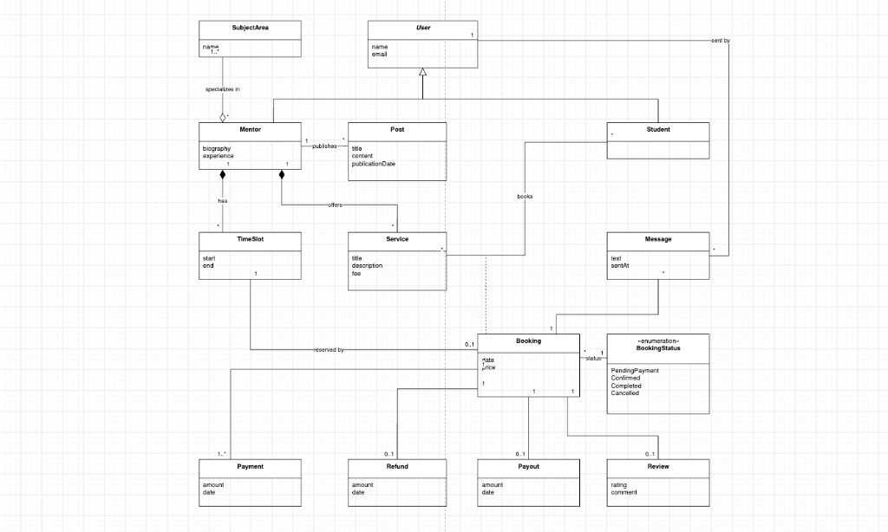
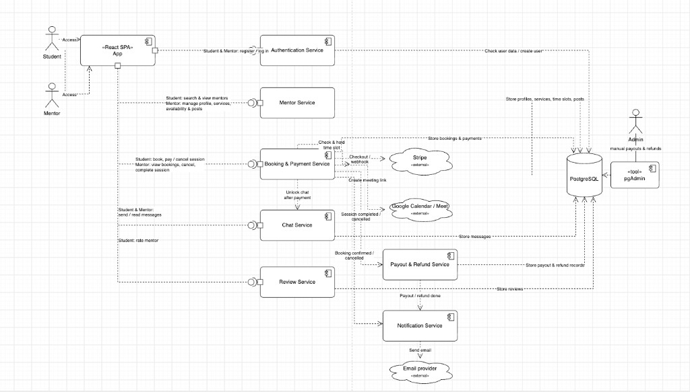

# Design Report — FEUP Connect

## 1. Project overview

A student at FEUP can be stuck on one idea after the lecture and the notes. Someone else already understands it: a classmate, a teaching assistant, a graduate, or an engineer who uses the idea at work. FEUP Connect is how the student finds that person, sees what they offer, and books a session with them.

The platform serves two kinds of people. Students come to search for help on a subject, compare mentors by what they offer and what they charge, and book and pay for a session. Mentors come to be found: they build a profile, describe what they can help with, and publish the sessions they offer. The same person can be both at once, learning from one mentor while being booked by someone else as a mentor themselves.

It starts with students helping students, and it includes tutors from outside the university, so the audience ranges from peers who just finished the same course to outside professionals who use the subject at work.

## 2. Domain discovery and modeling

### 2.1. EventStorming results

The EventStorming session covered the full flow, from mentor and student registration, and student searching and finding mentors through to booking, payment, sessions, payouts and refunds.

The board is on [Mural](https://app.mural.co/t/vuiworkspace8647/m/vuiworkspace8647/1792159724048/96beda2829dd92b771306787d9a867793835070d).

### 2.2. Domain model

The domain model covers the main concepts of the problem domain.

The diagram is on [diagrams.net](https://viewer.diagrams.net/?tags=%7B%7D&lightbox=1&highlight=0000ff&edit=_blank&layers=1&nav=1&title=Domain%20model%20and%20Component%20diagrams&dark=auto#R%3Cmxfile%20pages%3D%222%22%3E%3Cdiagram%20name%3D%22Domain%20model%20diagram%22%20id%3D%22f70IJ6838qOr__fpMa-q%22%3E7Z1dk6I4FIZ%2FjTdbNRaETy%2B77ZndrZqu6tre2Y9LlKjZAeICduv8%2Bg1IFAgtSBJotzM1VSMHgpLz8njykjgTYx7uf4697eYR%2BzCYAM3fT4yHCQC6Y9r4nzxyOEZmrnYMrJPAJ43OgefgByRB2mwX%2BDCtNMwQCrNgWw0uURzDZVaJeUmCXqvNViisvuvWW0Mm8Lz0Qjb6Z%2BBnm2PUtbRz%2FBcYrDf0nXWN7Ik82pgE0o3no9dSyPg8MeYJQtnxVbSfwzAfPDoux35f3th7%2BmAJjLMuHX799sf8j2%2FGQ5TE%2B%2F0%2BDcCj8e8niz0KOXCaHegYpK9BFHox3rpfoTh7JnsMvO2FwTrGr5e4O0xw4AUmWYCH747syNAWR5ebIPS%2Fege0y98kzbzld7p1v0FJ8AMf1gvxLh0H8O4kI0ow7KlWafOc98U78mgCU9zqiX52vRZ69PaVhl%2B9NCOBJQpDb5sGi%2BJE8kjkJesgvkdZhiIS2mQR%2FUirIAznKERJMSDGl%2BIPjh%2BH6sULd2SovqV4FI5BPBBwXxpSkpWfIYpglhxwk01JODOiktezyE7XADmKo4Epydeh2skjIl%2Bfjn3WAX5BpHCFLGxWFpfkU9IKPuesyGGCvkM6ZDE6iqc0iiRE9RPCVfametKttwzi9deizYN9jvxGxs%2FEIYT7rsLiAtsEvg%2FjPO8o8zLvnOQtCuKsGCvrHv%2FFozfX8JBa%2BIPP8bZ%2B3sZ%2F8%2BZJNkcxPhcvKIYBYgW9wjSrioMRQexFcALsMG%2B3wHKw1%2FkrGHlB2Esblvm2NogSDFuSEhwOQOgKEIw2nneLf%2FD31F0CvV5asGeMFvSZVeGE4Va1IY0SbkdKOIoSb1KihwQM420JyMbBTOFAKA4e8fsiYRVDGwlw3SpJF7rGCuOSgBQLKjJYBGidz58ODWXDfguTAMbLfrBoqB0Gg4XeMEdRtOCgxRPC79FHBTpNRVkGrjOt4sK2q8KQiAvQERc6qxfFCzwGQRY2TDGWWMT5eDI7trtFiM86C1D84GX9SOJYlyQknSWGYonYiUi28wutyJmE6Lo9WO1hdoWJoWDSoISbm4ToPK6lYgGrgN%2BDCD6HqB8MesxDzJk0FnR1LnVlXTYpoVBxwyQk9m9v9qGsS8EVA0xegp7T0H4TEImc6Opd6sq8vGIC4sN0mQTbfJ7B7lzBm5x4KMtTLEYeYZrmN90l1RrMxEMeREBX01NXrmcjRPIxYDCR4rG861eKjlluNC3IUJzg4MQ9Qt%2BxdvuVG6AdFDO9vpzClnanlE6yW0nRIBlFCgD8wrRkXM2kbznqjgkKHidTGwAUlnNboJjMweQOT1F3EUwKizsP3N%2BzejlFaIAgBp9ftkvpXpzUxblHH%2FhYF7yxt6oUiezpao8CZY82yesJxj7%2BdE%2FeIWq8t4KPuQqSCPpNu6JtCLPGXV68xMmD%2FXyVmd3KL8uRpSflvorl10lZw5ivM0Maabqar0CZr01C8CK0ayKM3%2FeW7ajzIWW%2FisXEb3C162nDN1Gi1XyVyImu5itQ5utonBjOYQXKYRVeUORnJameYH0TeaQwujqsQDms%2F%2FuKwlAOq%2BiK4iWAr7I4wVgcEjHR1V41lL3aJITcNsuddnY9adR7ZjoqKYiTBX3m4V4WHWiXLOGFg7HfLKWhTDBffeiTdOXvR4GDU7FBaxR74edzNF9Ic5c%2FlYwbLEKUwyEPfQny8zseIqYPQesg39wH2V%2F5rqljkM2%2FaUv8%2BmFf3jicjoEH8djLopt%2Fkw9cbJy7FVu03%2FFEMdDW8NJFZDH6aVZDAkOsq5dqBppyXXTFw%2BIdSg2I9M9HfsoDZ7xYoF6GALP2AHSth6vVS9paD%2Fzi%2BCnOyjudDocYTYFibFjCOooaLSXGsrR0YLVo692o0boBNJLv2qK2ojE%2FwMVs7P%2B%2BCWK6qyTUchmm2xWpgl7gPPYSLFaHEWu6hcsA1xQ%2FYJpnLuYUL9%2B3Jvk6Jj%2BlQcqQCei8zMVgbd087V%2B9BQxpYVsqbkpaaamqFqTSZSuXnzrXJo1jSLp8auMBc%2FXalSv3E6j2R6tVCjMmISIuX2f0HCXHGu%2BKJOnTqZg8XZ2mT6Plyb0dzFJU6mVOnr7h20hZxqQ2NcWAkq4WLomoeIQt3cD0CtmIR%2BSM9%2FJzB0ckHcqPgkhSRY2Zo%2BsR%2BdH4aOq3w8eOZWjdDbxUhuod4VorQzVBdGUnTRtvVK6agPOapXpSXJV3yRqj50hxtTVJIs2mm%2BCqq%2FfhqiUDq%2Bz0HicaJrxk7WePGnV7yTSpYfqWJeVY7uUeciwp0%2BIFi6ngL5srvN4Qf44U%2FFuT5AiEv7Q7DTXXQZv0cB30iRTXgQX4AqHvo%2FBb15hfezVAG8AbOllD3FQwXV46sAv9lHMsOEe81hV%2FjhTB25JEf1ZcDMEH8o2rd4M7l%2BCOI6EGPxVm7%2B5%2BsG2109tmnkitd5LDb0vnZAPVreK3PDTwWmT8Oepx5%2B%2Bj8VvkwrOh%2BN3rvl%2B9Agdi%2BM0602mxAFFbHK7QjTiOG7OWgrpLFx04g1Dc5CUEO%2BVTFBecI16viz9HiuKtSbJFUpxdcPOOqvAqxYElhuINVTgWJkxe8sfdR0K56dQrcgcMYI1YvAu2qBiVuS3veue1r%2FhzdD2Uten0w3F5JpDLDY%2BODVBdG06%2FdXWGIDAbjI5S8uM34y3%2BsHkXbFnsREnVrWIvPZvbIeLOkapbW5MEbpCPtft%2FNugKyDMTRfrH7%2BN5IpMuYqWlqjWIg2DzLvGiClTFqryLnNfl4c%2BRegKkS55EPmg3DozdzsWqlPV0gF2OMQaL66vinNkQJOZdb2UP%2FyzehyMxr7XDnyNlG3TJk8hn8QYjcb9FFVI4PBPNYT67gHchk62ewZN9yTm8lg5%2FjhQau%2BRJ5GN4w6HRdd8LG%2BkPSo293kxzq%2Fe2XLdlrRm7QK3WRU5d6wBOMDisyBS8BeeI1wXiz5GCd5c8iXzW7zK8WRj7XropaK5XyKyVyXz5x3akgJPJzgzUOUcXcJ0OcoQ86XdNmvBmglBWbp7%2FJ%2B6PyM91%2Fvk%2F%3C%2Fdiagram%3E%3Cdiagram%20id%3D%22Pc_xOG8s3eQwtYZtFQck%22%20name%3D%22Component%20diagram%22%3E7Z1bd6M2EIB%2FjR%2B7h7vNozfJbh%2By2zTenj72yCDbagBRIcfJ%2FvrqyiUQYmwCXjt5SGCQBZ5vRpfRiEzsq%2FjpKwHp5hsOYTSxjPBpYl9PLMucGg77wyXPUuK7UylYExSqQoVggX5CJTSUdItCmFUKUowjitKqMMBJAgNakQFC8K5abIWj6l1TsIY1wSIAUV36NwrpRkpnrlHIf4dovdF3Ng11JQa6sBJkGxDiXUlk30zsK4IxlUfx0xWMuPK0XuTnvrxyNX8wAhO6zwfo2qRT%2BnP643pjfvkR%2FmPde9Fvs4ZqlCijz1oJ7NFTfriNo3lAMZnYn3cbROEiBQGX7xh7JtvQOGJnJjt8hIQipsVbsITRHc4QRThh15aYUhyXCswjtOYXKOY1RLz4ZxA8rAneJuEVjvjN2CPYK%2FHDimSU4AdYumKIH3ZlhaKo6RMrnNCm8vJrPoJoq77mgm5DrgUpZw8In0oaUVr9CnEMKXlmRTYl8J6ivCuMxFYiVYk9Mz4ZBpNOPV%2F8lleVX1gGv2q69szx%2BG9bmbAy33V%2B14IwO1CQuwC3PoDnwL8xFbBSY%2FC2rYF42x%2B8c97zMEbJO%2BE2LafVv6cD8Xa68A5wnOJEFHwLOFAcA1YakgbAMQpDXv%2BrmFrA7gtwYnkglnb03xazv%2FcQsE7fMhZ38%2FwaUdeYgFVm8ormaXoQdr%2BO3XSr3F2jFftQbu7ug134HOT1GG8DD0G2EWXNF0wTZjEH4WxuErRhRXDFzTBjD4SS9a04uxb0lOgHL37tqRss1Ncym%2ByEtzAwCZlwcmNNZsbEd7gmWCXsM5bxnQ1TP%2F2b8ctM65Zx85QSmPHzlOBAHB1gLO60bi3WtGot09ZGwvQHshbvnBuJ%2BZZu2P3ZbUWfxBoHSB4Re%2BKeGv58RK%2BZeq0tgOkOw3R6zkz1SO0olu6xLO2hBumzc2b5GeMH1hKL1ld12ez4DjzHYvI1rrvKUfsAiP1zRny1AceSPNpZnYFG3L5xziTv4SOCu7FZuu5ALDuFw341lqyJxVv6ot29h6utGCmPCtgbaJ7kdwp%2F%2FWqAv2OKVv2Me48nOtBcxt8rwMUqQmkG3%2BbYnU6NwkH6Np2avrUonzo6beMWczaMuveKL529uh3DHkbde8V1zl%2Fds4Gse6%2FAyNmr2%2FUGUvdeMYtC3Xm%2FHOFt%2BB7q77BUSBB7lCLCXItMwyc2DkhA1BCWPmRe69aJvlyAMNzWie10mDiUv1fs4hSZfsVYhoevQASTEJCJjg9%2Fg5COy9rtxNrxBhp77RXEOEXWNzFA%2FOulBD%2BikA3Yh6PbsKTkdKLr%2BcN4cp7Ksudk6TlCCVOl%2FTbYpVyHul3mgnxF%2BI8tZdXohZ1M5gOZ7jtPjHFG1wQu%2Frw9rLs1G5ganZaHHXMYjzWNs45w1HyX54q1LQyn615zAmrttGW29skDhbVMQ40jYVjLdqubAd6SALbUNmto4lm9ekEWE7rBa8wazJtC%2Brm69FyyG9bTznmeHjtdRjh4kKIvKNIFupuFWB5WLUdhJhSQNaRt38up2dM80KvBdVMgMAIUPVb1%2BQ7o7D7RWR%2FoBkTn9InOPk90eY9UYheDZAvE8ExErGWiRhGyJiJkPTJbt0%2B2zjuxxSlMKmh50Upiz3Au6tUw5%2Fm2Fbpqqd%2BeC5hrlPHhhJ6JRZivG8sOezz23gf7Tux1jL6BvcCcQUCCzQs7UOuOsTCHrDRmKxsIayl4Ar%2BYyLFxJTu6EvWJhY9MnOWfA49szgeWKEL0%2BcW9UjYBGLk9mfZoU357X6ES%2BJrNJs%2FuA4TWZO1hy7fbgOm4Op59%2BG03v60Pqyp%2Bu8T4QXoc66jzNjoASSB2AWVsACZWIhtdV%2Fn3UmYDSV%2FNP1v2Wz4JjSCF5RrHtCK%2FT09tt6LxPHU2qo51QOXDU%2Ff1VLf76Cp3sEylSgvvJRCEotvNMtazjtspmmafruaeqKv54%2Bq419DQJbja6xMZOWcBoquK871l46HtM3Skv%2FapuY9vjKvjXmM8s%2FN3H71PoZItDIOHF%2F3Uhm%2FUZtWhWIz7IkzHxdxruOcSMPs1zH8lItLIBvkyOxysZGQn1Zn%2FY%2FLtNaTjnz9fnfVe7gX15MzQM7ZiVCnndRGXjEm51yCLcQGU67H5YvdOgJMVIvHpUe4zzKM1cNaUrRrl0lYBOSlUmwRCPmobFW6f0ZdhO%2BLK8FeVELLxDeCVMVnZBHZwuRHhvhHhW72GhS5gFKaTMctgCdQTVEhlQx6hZGSuvcZ5rAvgWh9dL2QQD8rExjFh9hpQao86nAXMPFWwYUq8zcQUKQQUFKMs7cHy4pioe81Nml4m6gXFpLSCnbUtYZfCIarc%2BCvX1kcErD8jKFZDq%2FkJMkQyMuheY2AXECNpA30S62tWn1GvS4iHtBEl4k0JIwPtNcB1AaGP1g656XUJeSSEwACTkZNQrT4jXXki7knx7sZxPBJdwlIHrKB2TdJuVkZl05J8mEb9lHa06A0tTSpTN7jDSKSZ6K3FVtuWl5nTuuVFWqmqsYBSv8n0iJtIa6rdRJDPtXWEMeiNue3sKXyiVd7lNqy8pUq9GXH%2Fzck4QryJEmdGiAgU78gEgXyFGuIbtNiJSqTrvO9JR%2BHKrwbRe6E0ntZ3387sgbY92V3iSgd45bEN22l6qNe6vbQnD22%2Fybt7qDWuh15LG8ldFDJDCmESFEm0KuKzirBIkoV0B6FeWhU7Mg97R2mD79ovX%2BvT7rvusZuP2Wnx0ntJtPjXAfbN%2Fw%3D%3D%3C%2Fdiagram%3E%3C%2Fmxfile%3E).

## 3. High-level architecture

High-level overview of the system.

The diagram is on [diagrams.net](https://viewer.diagrams.net/?tags=%7B%7D&lightbox=1&highlight=0000ff&edit=_blank&layers=1&nav=1&title=Untitled%20Diagram.drawio&page-id=Pc_xOG8s3eQwtYZtFQck&dark=auto#R%3Cmxfile%20pages%3D%222%22%3E%3Cdiagram%20name%3D%22Domain%20model%20diagram%22%20id%3D%22f70IJ6838qOr__fpMa-q%22%3E7Z1dk6I4FIZ%2FjTdbNRaETy%2B77ZndrZqu6tre2Y9LlKjsAHEBu3V%2B%2FQZMFAgtSBJotzM1VSOHBCXn5fHkJTgTYx7tf0687eYR%2BTCcAM3fT4yHCQC6Y9r4nzxyOEZmrnYMrJPAJ43OgefgByRB2mwX%2BDCtNMwQCrNgWw0uURzDZVaJeUmCXqvNViisvuvWW0Mm8Lz0Qjb6Z%2BBnm2PUtbRz%2FBcYrDf0nXWN7Ik82pgE0o3no9dSyPg8MeYJQtnxVbSfwzAfPDoux35f3th7%2BmAJjLMuHX799sf8j2%2FGQ5TE%2B%2F0%2BDcCj8e8niz0KOXCaHegYpK9BFHox3rpfoTh7JnsMvO2FwTrGr5e4O0xw4AUmWYCH747syNAWR5ebIPS%2Fege0y98kzbzld7p1v0FJ8AMf1gvxLh0H8O4kI0ow7KlWafOc98U78mgCU9zqiX52vRZ69PaVhl%2B9NCOBJQpDb5sGi%2BJE8kjkJesgvkdZhiIS2mQR%2FUirIAznKERJMSDGl%2BIPjh%2BH6sULd2SovqV4FI5BPBBwXxpSkpWfIYpglhxwk01JODOiktezyE7XADmKo4Epydeh2skjIl%2Bfjn3WAX5BpHCFLGxWFpfkU9IKPuesyGGCvkM6ZDE6iqc0iiRE9RPCVfametKttwzi9deizYN9jvxGxs%2FEIYT7rsLiAtsEvg%2FjPO8o8zLvnOQtCuKsGCvrHv%2FFozfX8JBa%2BIPP8bZ%2B3sZ%2F8%2BZJNkcxPhcvKIYBYgW9wjSrioMRQexFcALsMG%2B3wHKw1%2FkrGHlB2Esblvm2NogSDFuSEhwOQOgKEIw2nneLf%2FD31F0CvV5asGeMFvSZVeGE4Va1IY0SbkdKOIoSb1KihwQM420JyMbBTOFAKA4e8fsiYRVDGwlw3SpJF7rGCuOSgBQLKjJYBGidz58ODWXDfguTAMbLfrBoqB0Gg4XeMEdRtOCgxRPC79FHBTpNRVkGrjOt4sK2q8KQiAvQERc6qxfFCzwGQRY2TDGWWMT5eDI7trtFiM86C1D84GX9SOJYlyQknSWGYonYiUi28wutyJmE6Lo9WO1hdoWJoWDSoISbm4ToPK6lYgGrgN%2BDCD6HqB8MesxDzJk0FnR1LnVlXTYpoVBxwyQk9m9v9qGsS8EVA0xegp7T0H4TEImc6Opd6sq8vGIC4sN0mQTbfJ7B7lzBm5x4KMtTLEYeYZrmN90l1RrMxEMeREBX01NXrmcjRPIxYDCR4rG861eKjlluNC3IUJzg4MQ9Qt%2BxdvuVG6AdFDO9vpzClnanlE6yW0nRIBlFCgD8wrRkXM2kbznqjgkKHidTGwAUlnNboJjMweQOT1F3EUwKizsP3N%2BzejlFaIAgBp9ftkvpXpzUxblHH%2FhYF7yxt6oUiezpao8CZY82yesJxj7%2BdE%2FeIWq8t4KPuQqSCPpNu6JtCLPGXV68xMmD%2FXyVmd3KL8uRpSflvorl10lZw5ivM0Maabqar0CZr01C8CK0ayKM3%2FeW7ajzIWW%2FisXEb3C162nDN1Gi1XyVyImu5itQ5utonBjOYQXKYRVeUORnJameYH0TeaQwujqsQDms%2F%2FuKwlAOq%2BiK4iWAr7I4wVgcEjHR1V41lL3aJITcNsuddnY9adR7ZjoqKYiTBX3m4V4WHWiXLOGFg7HfLKWhTDBffeiTdOXvR4GDU7FBaxR74edzNF9Ic5c%2FlYwbLEKUwyEPfQny8zseIqYPQesg39wH2V%2F5rqljkM2%2FaUv8%2BmFf3jicjoEH8djLopt%2Fkw9cbJy7FVu03%2FFEMdDW8NJFZDH6aVZDAkOsq5dqBppyXXTFw%2BIdSg2I9M9HfsoDZ7xYoF6GALP2AHSth6vVS9paD%2Fzi%2BCnOyjudDocYTYFibFjCOooaLSXGsrR0YLVo692o0boBNJLv2qK2ojE%2FwMVs7P%2B%2BCWK6qyTUchmm2xWpgl7gPPYSLFaHEWu6hcsA1xQ%2FYJpnLuYUL9%2B3Jvk6Jj%2BlQcqQCei8zMVgbd087V%2B9BQxpYVsqbkpaaamqFqTSZSuXnzrXJo1jSLp8auMBc%2FXalSv3E6j2R6tVCjMmISIuX2f0HCXHGu%2BKJOnTqZg8XZ2mT6Plyb0dzFJU6mVOnr7h20hZxqQ2NcWAkq4WLomoeIQt3cD0CtmIR%2BSM9%2FJzB0ckHcqPgkhSRY2Zo%2BsR%2BdH4aOq3w8eOZWjdDbxUhuod4VorQzVBdGUnTRtvVK6agPOapXpSXJV3yRqj50hxtTVJIs2mm%2BCqq%2FfhqiUDq%2Bz0HicaJrxk7WePGnV7yTSpYfqWJeVY7uUeciwp0%2BIFi6ngL5srvN4Qf44U%2FFuT5AiEv7Q7DTXXQZv0cB30iRTXgQX4AqHvo%2FBb15hfezVAG8AbOllD3FQwXV46sAv9lHMsOEe81hV%2FjhTB25JEf1ZcDMEH8o2rd4M7l%2BCOI6EGPxVm7%2B5%2BsG2109tmnkitd5LDb0vnZAPVreK3PDTwWmT8Oepx5%2B%2Bj8VvkwrOh%2BN3rvl%2B9Agdi%2BM0602mxAFFbHK7QjTiOG7OWgrpLFx04g1Dc5CUEO%2BVTFBecI16viz9HiuKtSbJFUpxdcPOOqvAqxYElhuINVTgWJkxe8sfdR0K56dQrcgcMYI1YvAu2qBiVuS3veue1r%2FhzdD2Uten0w3F5JpDLDY%2BODVBdG06%2FdXWGIDAbjI5S8uM34y3%2BsHkXbFnsREnVrWIvPZvbIeLOkapbW5MEbpCPtft%2FNugKyDMTRfrH7%2BN5IpMuYqWlqjWIg2DzLvGiClTFqryLnNfl4c%2BRegKkS55EPmg3DozdzsWqlPV0gF2OMQaL66vinNkQJOZdb2UP%2FyzehyMxr7XDnyNlG3TJk8hn8QYjcb9FFVI4PBPNYT67gHchk62ewZN9yTm8lg5%2FjhQau%2BRJ5GN4w6HRdd8LG%2BkPSo293kxzq%2Fe2XLdlrRm7QK3WRU5d6wBOMDisyBS8BeeI1wXiz5GCd5c8iXzW7zK8WRj7XropaK5XyKyVyXz5x3akgJPJzgzUOUcXcJ0OcoQ86XdNmvBmglBWbp7%2FJ%2B6PyM91%2Fvk%2F%3C%2Fdiagram%3E%3Cdiagram%20id%3D%22Pc_xOG8s3eQwtYZtFQck%22%20name%3D%22Component%20diagram%22%3E7Z1bd6M2EIB%2FjR%2B7h7vNozfJbh%2By2zTenj72yCDbagBRIcfJ%2FvrqyiUQYmwCXjt5SGCQBZ5vRpfRiEzsq%2FjpKwHp5hsOYTSxjPBpYl9PLMucGg77wyXPUuK7UylYExSqQoVggX5CJTSUdItCmFUKUowjitKqMMBJAgNakQFC8K5abIWj6l1TsIY1wSIAUV36NwrpRkpnrlHIf4dovdF3Ng11JQa6sBJkGxDiXUlk30zsK4IxlUfx0xWMuPK0XuTnvrxyNX8wAhO6zwfo2qRT%2BnP643pjfvkR%2FmPde9Fvs4ZqlCijz1oJ7NFTfriNo3lAMZnYn3cbROEiBQGX7xh7JtvQOGJnJjt8hIQipsVbsITRHc4QRThh15aYUhyXCswjtOYXKOY1RLz4ZxA8rAneJuEVjvjN2CPYK%2FHDimSU4AdYumKIH3ZlhaKo6RMrnNCm8vJrPoJoq77mgm5DrgUpZw8In0oaUVr9CnEMKXlmRTYl8J6ivCuMxFYiVYk9Mz4ZBpNOPV%2F8lleVX1gGv2q69szx%2BG9bmbAy33V%2B14IwO1CQuwC3PoDnwL8xFbBSY%2FC2rYF42x%2B8c97zMEbJO%2BE2LafVv6cD8Xa68A5wnOJEFHwLOFAcA1YakgbAMQpDXv%2BrmFrA7gtwYnkglnb03xazv%2FcQsE7fMhZ38%2FwaUdeYgFVm8ormaXoQdr%2BO3XSr3F2jFftQbu7ug134HOT1GG8DD0G2EWXNF0wTZjEH4WxuErRhRXDFzTBjD4SS9a04uxb0lOgHL37tqRss1Ncym%2ByEtzAwCZlwcmNNZsbEd7gmWCXsM5bxnQ1TP%2F2b8ctM65Zx85QSmPHzlOBAHB1gLO60bi3WtGot09ZGwvQHshbvnBuJ%2BZZu2P3ZbUWfxBoHSB4Re%2BKeGv58RK%2BZeq0tgOkOw3R6zkz1SO0olu6xLO2hBumzc2b5GeMH1hKL1ld12ez4DjzHYvI1rrvKUfsAiP1zRny1AceSPNpZnYFG3L5xziTv4SOCu7FZuu5ALDuFw341lqyJxVv6ot29h6utGCmPCtgbaJ7kdwp%2F%2FWqAv2OKVv2Me48nOtBcxt8rwMUqQmkG3%2BbYnU6NwkH6Np2avrUonzo6beMWczaMuveKL529uh3DHkbde8V1zl%2Fds4Gse6%2FAyNmr2%2FUGUvdeMYtC3Xm%2FHOFt%2BB7q77BUSBB7lCLCXItMwyc2DkhA1BCWPmRe69aJvlyAMNzWie10mDiUv1fs4hSZfsVYhoevQASTEJCJjg9%2Fg5COy9rtxNrxBhp77RXEOEXWNzFA%2FOulBD%2BikA3Yh6PbsKTkdKLr%2BcN4cp7Ksudk6TlCCVOl%2FTbYpVyHul3mgnxF%2BI8tZdXohZ1M5gOZ7jtPjHFG1wQu%2Frw9rLs1G5ganZaHHXMYjzWNs45w1HyX54q1LQyn615zAmrttGW29skDhbVMQ40jYVjLdqubAd6SALbUNmto4lm9ekEWE7rBa8wazJtC%2Brm69FyyG9bTznmeHjtdRjh4kKIvKNIFupuFWB5WLUdhJhSQNaRt38up2dM80KvBdVMgMAIUPVb1%2BQ7o7D7RWR%2FoBkTn9InOPk90eY9UYheDZAvE8ExErGWiRhGyJiJkPTJbt0%2B2zjuxxSlMKmh50Upiz3Au6tUw5%2Fm2Fbpqqd%2BeC5hrlPHhhJ6JRZivG8sOezz23gf7Tux1jL6BvcCcQUCCzQs7UOuOsTCHrDRmKxsIayl4Ar%2BYyLFxJTu6EvWJhY9MnOWfA49szgeWKEL0%2BcW9UjYBGLk9mfZoU357X6ES%2BJrNJs%2FuA4TWZO1hy7fbgOm4Op59%2BG03v60Pqyp%2Bu8T4QXoc66jzNjoASSB2AWVsACZWIhtdV%2Fn3UmYDSV%2FNP1v2Wz4JjSCF5RrHtCK%2FT09tt6LxPHU2qo51QOXDU%2Ff1VLf76Cp3sEylSgvvJRCEotvNMtazjtspmmafruaeqKv54%2Bq419DQJbja6xMZOWcBoquK871l46HtM3Skv%2FapuY9vjKvjXmM8s%2FN3H71PoZItDIOHF%2F3Uhm%2FUZtWhWIz7IkzHxdxruOcSMPs1zH8lItLIBvkyOxysZGQn1Zn%2FY%2FLtNaTjnz9fnfVe7gX15MzQM7ZiVCnndRGXjEm51yCLcQGU67H5YvdOgJMVIvHpUe4zzKM1cNaUrRrl0lYBOSlUmwRCPmobFW6f0ZdhO%2BLK8FeVELLxDeCVMVnZBHZwuRHhvhHhW72GhS5gFKaTMctgCdQTVEhlQx6hZGSuvcZ5rAvgWh9dL2QQD8rExjFh9hpQao86nAXMPFWwYUq8zcQUKQQUFKMs7cHy4pioe81Nml4m6gXFpLSCnbUtYZfCIarc%2BCvX1kcErD8jKFZDq%2FkJMkQyMuheY2AXECNpA30S62tWn1GvS4iHtBEl4k0JIwPtNcB1AaGP1g656XUJeSSEwACTkZNQrT4jXXki7knx7sZxPBJdwlIHrKB2TdJuVkZl05J8mEb9lHa06A0tTSpTN7jDSKSZ6K3FVtuWl5nTuuVFWqmqsYBSv8n0iJtIa6rdRJDPtXWEMeiNue3sKXyiVd7lNqy8pUq9GXH%2Fzck4QryJEmdGiAgU78gEgXyFGuIbtNiJSqTrvO9JR%2BHKrwbRe6E0ntZ3387sgbY92V3iSgd45bEN22l6qNe6vbQnD22%2Fybt7qDWuh15LG8ldFDJDCmESFEm0KuKzirBIkoV0B6FeWhU7Mg97R2mD79ovX%2BvT7rvusZuP2Wnx0ntJtPjXAfbN%2Fw%3D%3D%3C%2Fdiagram%3E%3C%2Fmxfile%3E).

## 4. Future change scenarios: coupling, cohesion, and design decisions

### 4.1. Scenario 1: Hardcoded, duplicated commission fee (Iteration 1)

#### Change scenario and design context

Right now, the application charges a fixed commission of 1.50 Euros on every booking. This is implemented independently in two places: the backend calculates the final charge sent to Stripe by adding the fixed amount of 1.50 Euros to the session price, while the frontend holds its own fixed amount value of 1.50 Euros that it renders during the checkout preview.

The plausible future change is that the applications changes this fixed fee to a percentage based commission that admins can configure and change anything, for example taking 12% of the session price, adjustable from a settings screen. This is more realistic and less rigid.

#### Coupling and cohesion analysis

| Relationship | Integration strength | Evidence for strength                                                                                                                                                               | Distance | Evidence for distance                                                                                                                                              | Volatility | Evidence for volatility                                                                                                                     |
| ------------ | -------------------- | ----------------------------------------------------------------------------------------------------------------------------------------------------------------------------------- | -------- | ------------------------------------------------------------------------------------------------------------------------------------------------------------------ | ---------- | ------------------------------------------------------------------------------------------------------------------------------------------- |
| A            | Functional coupling  | Both the frontend preview and the backend logic independently handle the same commission rule, neither depends on the other's internals, but both share the same business knowledge | D5       | The frontend and the backend service are different runtimes and different programming languages entirely, further apart than any package split within one codebase | V4         | Under the proposed change, the commission becomes admin configurable and is expected to change maybe monthly                                |
| B            | Model coupling       | The function that creates a pending booking reads and depends on the structure of the stored session price record directly                                                          | D2       | The price is read and the charge is computed within the same file and the same module                                                                              | V2         | The mechanism of reading the price and computing a charge is itself stable, only the externally configured rate value it references changes |
| C            | Model coupling       | A straightforward implementation would have the booking module query the settings table directly, requiring it to know that table's schema                                          | D4       | This setting would live in a new, separate top level module, distinct from the booking module                                                                      | V4         | The entire purpose of this feature is to let administrators change the commission rate frequently, expected approximately monthly           |

**Relationship A: Commission preview**

Classification: Functional coupling / D5 / V4

Both the frontend and the backend need knowledge of the commission rule. This is therefore more than simply knowing an interface or sharing a domain data structure. The shared knowledge is highly volatile, and the coupling is also very distant: the two locations are not just in different packages but in different runtimes and languages entirely.

Assessment: This is not well balanced and deserves design attention. The combination of functional knowledge, large distance, and high volatility means a frequently changing business rule can easily become inconsistent across the system. If an admin changes the commission from twelve percent to fifteen percent, one implementation could be updated while the other remains unchanged.

**Relationship B: Fee calculation**

Classification: Model coupling / D2 / V2

The checkout function depends on the structure of the stored session price, which is more than a narrow contract but less than depending on behavior or business rules spread elsewhere. The shared knowledge is close: both the read and the computation happen in the same file.

Assessment: This is an appropriately balanced coupling. The coupling is local, and the knowledge involved is stable. There is no pressing reason to redesign this relationship on its own.

**Relationship C: Commission configuration**

Classification: Model coupling / D4 / V4

If implemented naively, the booking module would understand the structure of the settings table directly, which is more than simply calling a function and receiving a rate. The shared knowledge is distant, since this setting would live in its own module, and highly volatile, since frequent administrator changes are the entire point of the feature.

Assessment: This is not well balanced and warrants deliberate design attention before it is even built. Since distance and volatility are both fixed by the nature of the feature, the only dimension available to improve is integration strength — this relationship should be designed as contract coupling from the outset rather than model coupling.

Cohesion here means keeping strongly coupled, volatile, shared knowledge at a short distance rather than scattered apart.

Relationship A is not cohesive: the commission rule is strongly coupled and highly volatile, yet it is split across the greatest possible distance. The same kind of knowledge sharing can be well designed when kept within one package at a short distance, as Relationship B shows, here it is simply placed badly.

Fixing Relationship A is properly a cohesion fix, not merely a decoupling fix. Collapsing the rule into a single module relocates the volatile knowledge back to one place, turning a relationship that was not cohesive into one that is.

At the level of business domain analysis, commission and platform fee rules form a set of interrelated use cases in their own right, matching the definition of a business subdomain. This knowledge currently has no home of its own, it is split between the booking subdomain and the frontend. It is arguably a candidate for a core subdomain if commission strategy becomes a genuine business differentiator, rather than an incidental detail living inside booking. Giving it an explicit bounded context — a dedicated module with its own language such as "commission rate," "platform fee," and "net payout" is the natural counterpart to the coupling fix above.

#### Alternatives, decision, and consequences

I would introduce a single backend feature responsible for pricing that owns the commission rule end to end, one function that calculates the charge a student pays, and one function that calculates the payout owed to the mentor, both reading the commission rate from a dedicated pricing subdomain's own storage.

The booking feature would call this service instead of owning the calculation itself, converting Relationship B from model coupling toward contract coupling. The frontend would stop hardcoding its own fixed commission value, the checkout page would only display the breakdown already computed by the backend and returned through the checkout response, converting Relationship A from functional coupling to plain data coupling. The distance between frontend and backend remains unavoidably large, but what crosses that distance is now just numbers, not a duplicated business rule. The administrator settings screen would read and write the commission rate only through the pricing module's own interface, never by reaching directly into the booking module's internals, choosing contract coupling for Relationship C from the start instead of the naive model coupling shown above.

This is better balanced rather than simply "more decoupled" because the distance in Relationship A cannot be reduced, frontend and backend will always be separate runtimes, so the redesign does not try to fight distance. Instead, it collapses the volatile, strongly shared knowledge into a single place, restoring cohesion, and it deliberately selects the weakest available integration strength for Relationship C, whose distance and volatility cannot be lowered. When volatility and distance are fixed, integration strength is the only lever left worth spending design effort on.

### 4.2. Scenario 2: Mentor search that runs entirely in the browser (Iteration 2)

#### Change scenario and design context

Right now, the backend does no searching. `GET /api/mentors` (`findPublicMentors`) returns every completed, non banned mentor with their full public profile: bio, skills, subjects, every service and every future availability slot. To build that list, it loads each mentor separately (one query for the list, then three queries per mentor for the profile, services and availability). The frontend then does all of the search work on that full list:

- `matchesMentorSearch` (`frontend/src/lib/mentorSearch.ts`) decides which fields are searchable (name, skills, subjects, service titles and descriptions) and how text matches: accent-insensitive, every word must appear somewhere.
- `MentorDirectory` (`frontend/src/components/mentors/MentorDirectory.tsx`) applies the filters: subject, minimum rating, language, and a price range checked against the mentor's cheapest service.
- The filter options and limits are hardcoded in the frontend: the three languages in `LANGUAGE_CODES` and the default price range of €10–€50.

The plausible future change is that search has to work on the server. FEUP Connect's purpose is helping a student find the right person. As more students, teaching assistants, graduates and outside tutors join, the product will need paginated results, ranking (by relevance, rating, price or the soonest available slot) and new filters such as "available this week". None of this can work while the browser has to download every mentor, including every future slot, before it can show a single result. Once results come back one page at a time, a filter running in the browser can only see the current page, so the search rules cannot stay where they are.

The current placement is already causing errors:

- The language filter never matches. Mentors store language names (`'Portuguese'`, `'English'`), and the frontend joins them into one string, `"Portuguese, English"`. The filter then looks for codes such as `'PT'` in that string, so choosing any language returns no mentors.
- The default price range is €10–€50, but the backend accepts service prices from €0.50 to €1000. A mentor whose cheapest service costs €5 or €60 is hidden from the directory until the student moves the price slider.
- `rating` is always `0` (it is set in `toMentor`, because there are no reviews yet), so the rating filter has no data to work with.

#### Coupling and cohesion analysis

| Relationship | Integration strength | Evidence for strength                                                                                                                                                                                                                               | Distance | Evidence for distance                                                                                                              | Volatility | Evidence for volatility                                                                                                                                                                   |
| ------------ | -------------------- | --------------------------------------------------------------------------------------------------------------------------------------------------------------------------------------------------------------------------------------------------- | -------- | ---------------------------------------------------------------------------------------------------------------------------------- | ---------- | ----------------------------------------------------------------------------------------------------------------------------------------------------------------------------------------- |
| A            | Model coupling       | To search, the mentor directory depends on the backend's full public profile model: services with prices, subjects, skills and bio. It derives search facts from that model itself, for example "the lowest price" as the minimum over all services | D5       | The directory runs in the browser and the profile model is built by SQL in the backend: different runtimes and different languages | V4         | Searching and ranking are how the product delivers its core value. New filters, ranking rules and pagination are among the first things expected to change as the number of mentors grows |
| B            | Functional coupling  | The frontend holds its own copy of rules the backend owns: which languages exist and how they are written, and what price range is allowed. These copies have already drifted, which caused the broken language filter and the hidden mentors       | D5       | The rules are enforced in backend validation and stored data, and copied into constants in a React component                       | V3         | Mentors choose languages from an external list (LibreTranslate), and each new mentor or price change can fall outside the hardcoded options                                               |
| C            | Contract coupling    | `findPublicMentors` builds the list by calling `findPublicMentor` once for each mentor, reusing its public interface without knowing how it works inside                                                                                            | D2       | Both functions are in the same file, `mentors.queries.ts`                                                                          | V2         | The public profile page needs a single profile, and how it is loaded rarely changes                                                                                                       |

**Relationship A: The directory searches the backend's profile model**

Classification: Model coupling / D5 / V4

The frontend does not ask the backend a question such as "which mentors teach databases for under €20?". Instead, it downloads the backend's profile model and works out the answer itself. That gives the browser two responsibilities: knowing the structure of a mentor's profile, and owning the search rules applied to it. The model is shared across the largest possible distance, and the rules on top of it are the most likely part of the product to change.

Assessment: This is not well balanced and needs design attention. As long as the list is small and the rules are simple, the cost is hidden. However, every planned change (pagination, ranking, an availability filter) needs the search rule to see all mentors, which only the database can do. The payload also grows with every mentor and every slot, even though the result card shows only a small part of it.

**Relationship B: Filter options copied into the frontend**

Classification: Functional coupling / D5 / V3

The filter panel only works if its options match the values the backend actually stores. That knowledge is written twice: once by the backend (stored language names, price validation from €0.50 to €1000) and again in frontend constants (`LANGUAGE_CODES`, the €10–€50 default range). Nothing connects the two copies.

Assessment: This is not well balanced, and the current bugs show the cost: duplicated knowledge at a large distance that has already drifted apart, with no error raised. Students simply see fewer mentors, or none at all.

**Relationship C: Building the list from the single-profile query**

Classification: Contract coupling / D2 / V2

Reusing `findPublicMentor` is good design from a coupling point of view: it is weak integration, close by, and stable.

Assessment: In terms of coupling, this is well balanced and should not be redesigned for its own sake. The problem is cost, not coupling: about three queries per mentor on every directory visit. Search should not be built on top of it. A search query should be a separate read path that fetches only what a result card needs, while `findPublicMentor` stays as it is for the profile page.

Cohesion here means that the rules for finding a mentor should live together, next to the data they search.

Today, search knowledge is split across three places: the matching rule lives in `mentorSearch.ts`, the filters and their limits in `MentorDirectory.tsx`, and the data they depend on in the database. Even the frontend part is not cohesive, because the filter constants copy rules from backend validation. Moving the search rules to the backend brings this volatile knowledge together in one place, next to the data, where a single SQL query can filter, rank and paginate all mentors at once.

At the level of business domain analysis, matching a student with the right mentor is FEUP Connect's core subdomain. The vision describes the product as "how the student finds that person". Core subdomains change the most and deserve the most care, so the search rules should not live inside a UI component. They belong in a dedicated discovery area in the backend, with its own language: "search criteria", "search result", "relevance" and "starting price". That area should have a read model built for discovery, separate from the profile model used for editing and display.

#### Alternatives, decision, and consequences

I considered three options.

1. **Keep search in the browser, but fix it.** Make the language filter compare names, remove the hardcoded price defaults, hide the rating filter until reviews exist, and return a smaller list. This is the cheapest option and fixes today's bugs. However, it does not support pagination or ranking, and Relationships A and B stay as they are.
2. **Use a dedicated search engine (Meilisearch, Elasticsearch or Algolia).** This would give typo tolerance and better ranking. I rejected it for now: it adds another service to run, and the index has to be kept in sync with PostgreSQL. That sync would create a new distant, volatile coupling, which is too much for FEUP's scale. It could be reconsidered if relevance ranking becomes a real differentiator.
3. **Move search into a backend query (chosen).** The backend owns the search criteria, filtering, ranking and pagination, and the frontend only sends the criteria and shows the results.

Under the chosen design, `GET /api/mentors` would accept the search criteria as validated query parameters (`q`, `subjects`, `languages`, `priceMin`, `priceMax`, `sort`, `page`, `pageSize`) and run a single SQL query.

- **Matching:** the query would match text against the same fields as today, keeping matching accent-insensitive with PostgreSQL's `unaccent` extension (added in a migration).
- **Price:** it would compute each mentor's starting price in SQL.
- **Response:** it would return one page of result cards plus the total count: `{ results: [{ id, name, headline, subjects, skills, languages, startingPriceCents }], total, page }`.
- **Filter options:** subjects and languages, with their counts and the actual price range, would come from the backend rather than frontend constants, for example from a `GET /api/mentors/search/options` endpoint. Subjects can reuse the existing categories endpoint.

This changes Relationship A from model coupling to contract coupling: the frontend sends criteria and receives a read model designed for search, and it no longer knows how profiles, services or slots are structured. Relationship B is removed, because the filter options are read from the data instead of copied. Relationship C stays as it is and is used only by the profile page.

The consequences are not all positive:

- Every search or filter change becomes a request. The directory needs debounced input, loading and error states, and the search state should be kept in the URL so results can be shared and the back button works.
- The search tests move. The unit tests for `matchesMentorSearch` become backend integration tests against PostgreSQL, and they must cover accents, multi-word queries and every filter.
- The API changes shape. `MentorDirectory` is used by both the public mentors page and the signed-in dashboard, so both must move to the new API at the same time.
- Ranking by soonest available slot and filtering by rating stay out of scope until those concepts exist in the data: there is no reviews table yet. The rating filter should be hidden until there is data behind it rather than shown with no effect.

This is better balanced, not just more decoupled. The frontend and backend distance does not change, but what crosses it changes from a whole domain model plus the rules applied to it, to a small set of criteria going out and a small read model coming back. The search rules, the most likely part of the product to change, now live in one place next to the data they search. The reuse in Relationship C, which was already balanced, is left alone.
