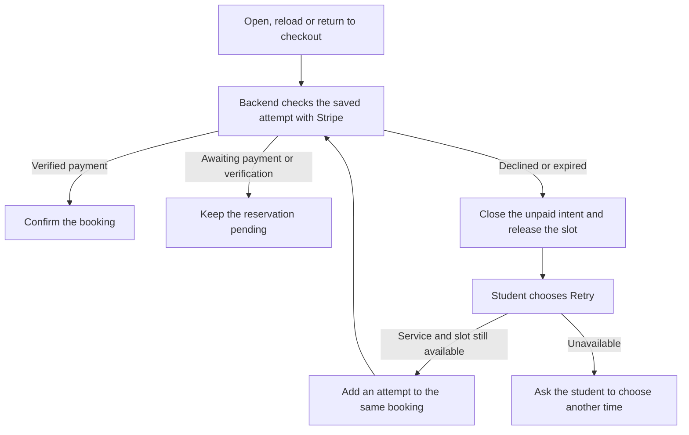

# Stripe payments

We use Stripe Elements and PaymentIntents in test mode. The backend gets the student from their session, checks the service and available slot, and calculates the service price plus the €1.50 fee. It saves a booking and payment attempt before creating the PaymentIntent. Opening or reloading checkout resumes that booking and shows its saved outcome.

Stripe verification runs during booking, dashboard and checkout requests. At the ten-minute deadline the backend checks the intent and cancels it if unpaid. If Stripe verifies a successful payment while the reservation is still held, the backend confirms the booking. If Stripe cannot verify or cancel the intent, the slot stays reserved until a later request can resolve it.

Failed and expired attempts remain in the database. A retry keeps the booking reference and price and gets a separate payment attempt once the service and slot have been checked again. Repeating the same request returns the existing attempt. Only the student who owns the booking can open or retry its checkout.

If an interrupted Stripe creation cannot be recovered within 23 hours, the reservation stays pending for manual investigation. Reusing an older key could create a second PaymentIntent once Stripe removes that key.
