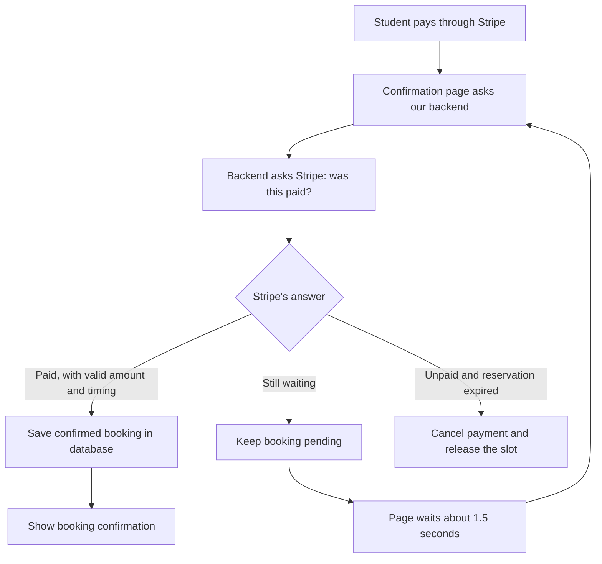

# Stripe payments

We use Stripe Elements and PaymentIntents in test mode. No real money moves. The backend gets the student from their session, checks the service and available slot, and calculates the service price plus the €1.50 fee. It saves a pending booking and payment before creating the PaymentIntent. The browser receives the client secret to show Stripe's payment form; the Stripe secret API key stays on the backend. A slot is reserved for ten minutes.

We still poll Stripe, but only during booking, dashboard and checkout requests. The old backend timer that checked every five seconds is gone; there are no webhooks. The confirmation page asks again about every 1.5 seconds while payment is pending and requests succeed. The backend checks Stripe's payment status, amount, euro currency and paid charge, and compares its charge timestamp with the reservation deadline before confirming the booking in PostgreSQL. Checkout checks only its own retry and expired reservations for the requested slot, so an unrelated payment error does not block another student. Expired attempts cannot be reused, and interrupted attempts without an attached PaymentIntent are cleaned up when observed. If Stripe cannot verify a payment, its slot stays reserved. If everyone closes the app, database updates wait until a relevant request arrives. Mentor payouts are not implemented.
